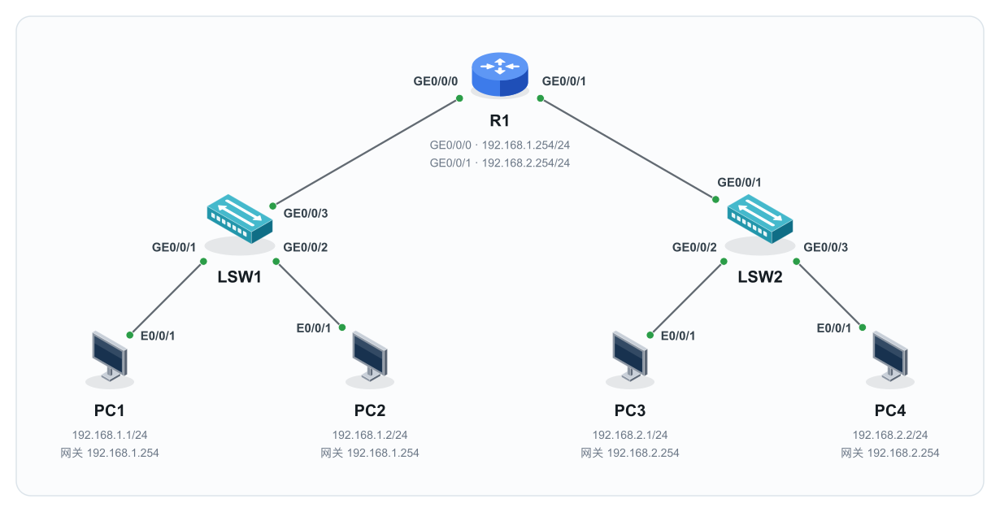
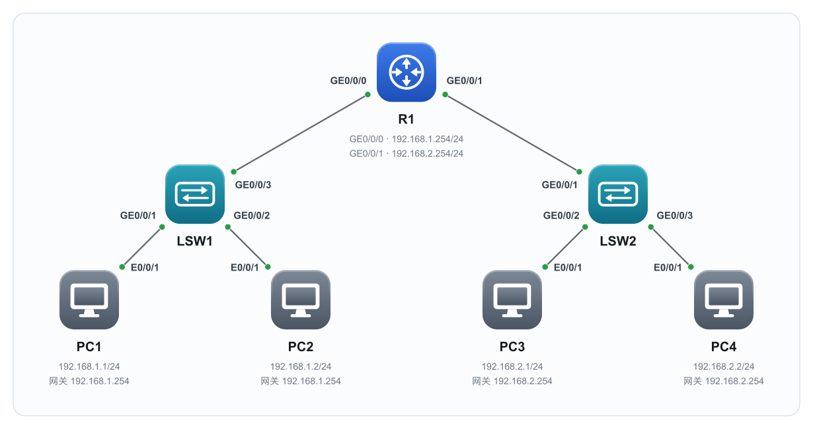
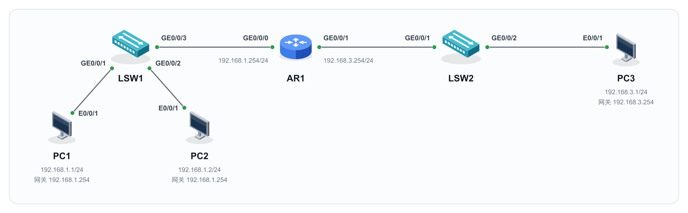
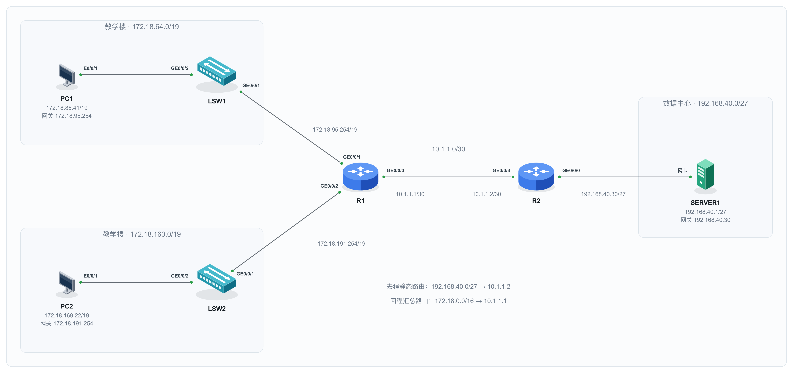
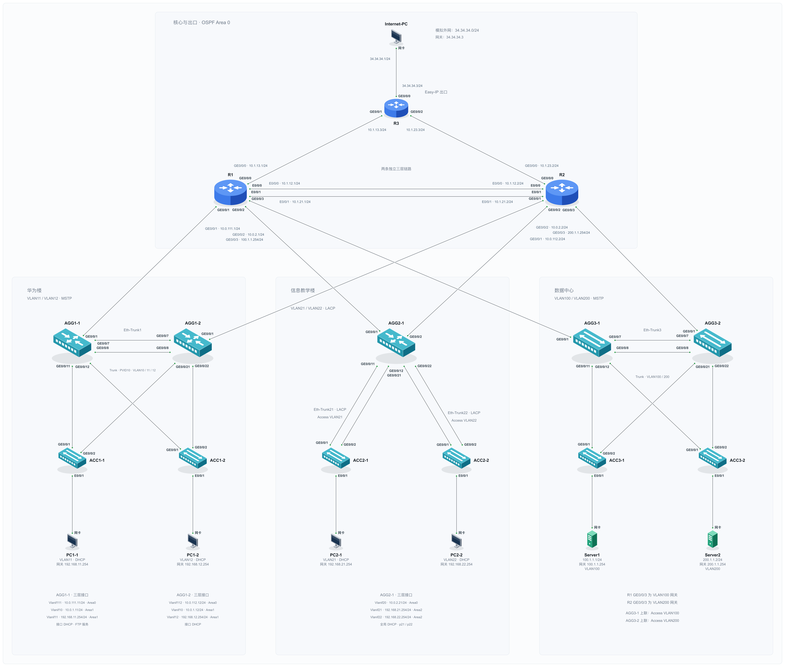

# net-topo-svg · Network Topology Drawing Agent Skill

[简体中文](README.md) | English

Describe devices, connections, interfaces, and addresses in JSON to generate self-contained SVG network topologies. Use them in network courses, lab manuals, and other documents.

Choose between **2.5D device illustrations** and **polished rounded icons**, with 32 device types in each style. The default is 2.5D.

## Preview

| 2.5D (default) | Rounded icons |
| --- | --- |
|  |  |

### Basic routing and endpoint access



### Static routing and route summarization



### Campus network



## Features

- 32 device types, including routers, Layer 2/Layer 3 switches, PCs, servers, wireless devices, and firewalls. Both styles share the same device IDs.
- Four automatic layouts: `backbone`, `hierarchical`, `aggregation`, and `access`. Use explicit coordinates with `manual` for complex topologies.
- Link endpoints calculated from device outlines, interface labels at both ends, device names arranged in groups, and separate placement for IP addresses, VLANs, and other annotations.
- Automatic framing based on all graphics and text, with centered content and balanced margins.
- Embedded SVG icons, with no image hosting or external images required. Includes structural and layout checks and a test suite.

## Quick start

SVG generation and validation use only the Python 3 standard library. No third-party Python packages are required.

```bash
git clone https://github.com/fuchu8/net-topo-svg.git
cd net-topo-svg

# Use the default 2.5D style
python3 scripts/topology.py examples/basic-access.json --strict -o topology.svg

# Use rounded icons
python3 scripts/topology.py examples/hierarchical-access.json --style rounded --strict -o rounded.svg

# Validate the output
python3 scripts/check_topology.py topology.svg

# List available device icons
python3 scripts/topology.py --list-icons
```

Open the generated SVG in a browser. Copy the closest example JSON, then edit its devices, links, and annotations. See the [JSON input guide](references/input-format.md) for the input format. Example addresses are for demonstration only; when drawing an existing lab, use the actual addresses and interfaces from its source material.

## Use as an Agent Skill

Place the complete `net-topo-svg` directory in a skills directory supported by your agent host. Preserve the relative locations of `SKILL.md`, `scripts/`, `assets/`, `references/`, and the other bundled files. The host must be able to read skill files and run Python scripts.

Example request:

> Use $net-topo-svg to draw a rounded-style topology based on the hierarchical-access example: one router, two switches, and two PCs connected to each switch. Generate and validate the SVG using the interfaces and addresses I provide.

See [SKILL.md](SKILL.md) for detailed drawing and review rules. If no style is specified, use 2.5D. Use one icon style throughout each diagram. The skill instructions and detailed reference documents are currently in Chinese.

## Optional: export PNG

PNG conversion requires Node.js and `sharp`. They are not required for SVG generation or validation.

```bash
# Install the optional conversion dependency in this repository
npm install --no-save --package-lock=false sharp

python3 scripts/render_preview.py --sharp "$PWD/node_modules/sharp" \
  -o topology.png < topology.svg
```

You can also use `--node` and `--sharp` to specify an existing Node.js executable and sharp module path provided by your host.

## Examples and documentation

| Content | File |
| --- | --- |
| Basic backbone and access | [basic-access.json](examples/basic-access.json) |
| Hierarchical network | [hierarchical-access.json](examples/hierarchical-access.json) |
| Link aggregation | [link-aggregation.json](examples/link-aggregation.json) |
| Multiple endpoints | [multi-access.json](examples/multi-access.json) |
| Working with examples | [references/examples.md](references/examples.md) |
| Input format and layout parameters | [references/input-format.md](references/input-format.md) |
| Visual specifications | [references/style-spec.md](references/style-spec.md) |
| Icon catalog and extension rules | [references/icon-spec.md](references/icon-spec.md) |

## Validation

```bash
python3 -B -m unittest discover -s tests -v
```

`--strict` stops output when structural errors or layout warnings are detected. Automated checks use approximate geometry; render complex topologies and visually check interface ownership, text, and links.

Obsidian image hosting can be handled by the separate `obsidian-cos-images` skill, which is not a runtime dependency of this project. This project outputs SVG/PNG; it does not produce native editable PowerPoint shapes or packet sequence diagrams.
