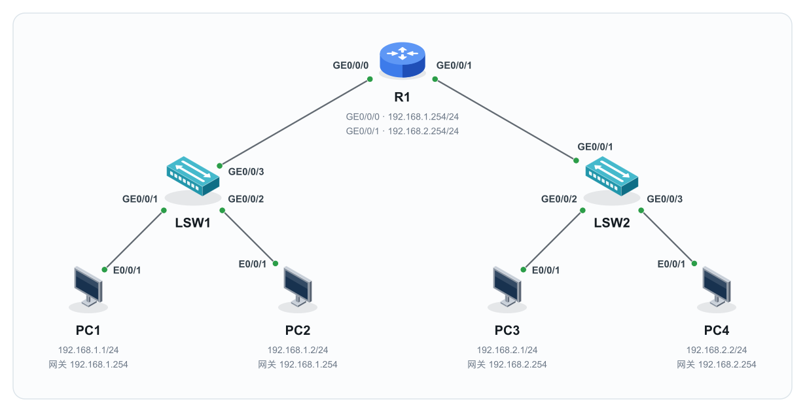
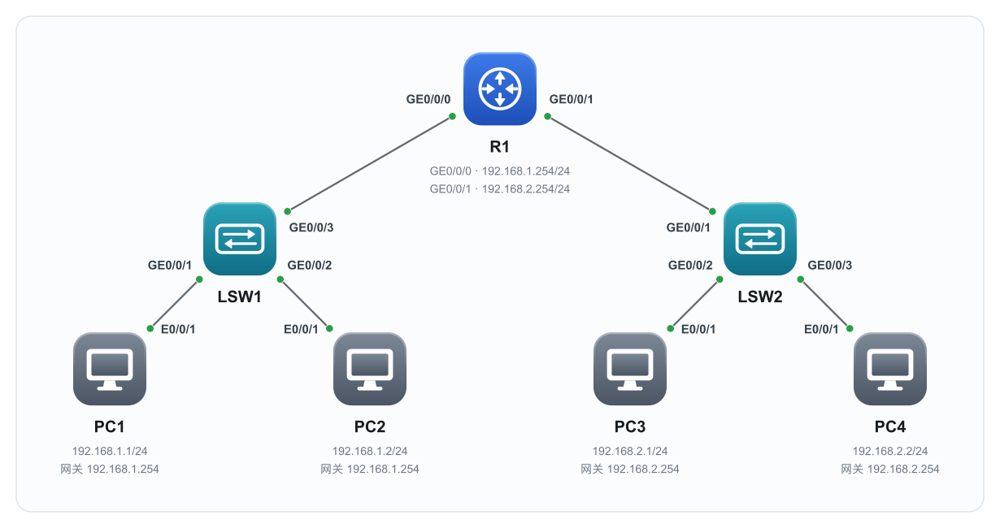
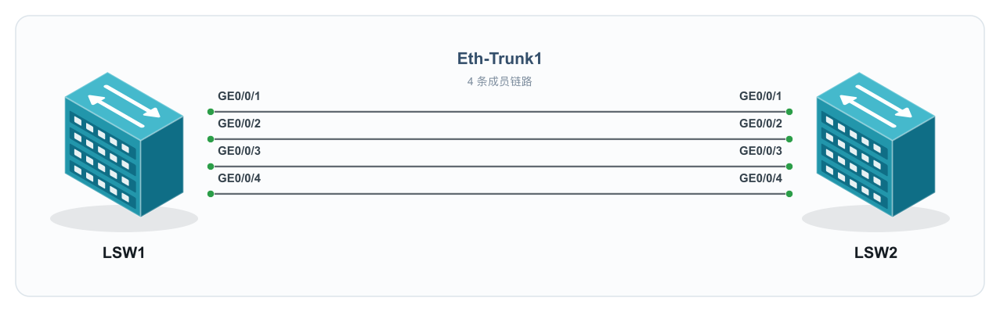
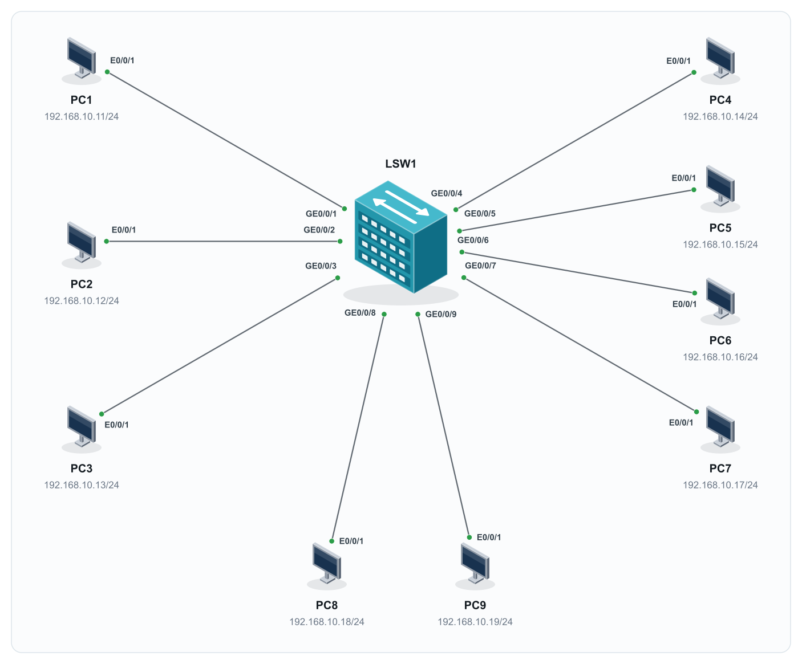

# net-topo-svg · 网络拓扑绘图 Agent Skill

把设备、连接、接口和地址写成 JSON，生成自包含的 SVG 网络拓扑。可用于网络课程、实验手册等文档中的拓扑图输出。

支持 **2.5D 立体设备**与**精修圆角色块**两种风格，每套包含 32 类设备图标；默认使用 2.5D。

## 效果预览

| 2.5D（默认） | 圆角色块 |
| --- | --- |
|  |  |

| 链路聚合 | 多终端接入 |
| --- | --- |
|  |  |

## 功能

- 32 类设备：路由器、二层/三层交换机、PC、服务器、无线设备、防火墙等。两套风格使用相同的设备 ID。
- 4 种自动布局：横向主干 `backbone`、分层树形 `hierarchical`、链路聚合 `aggregation`、多终端接入 `access`；复杂拓扑可使用 `manual` 坐标布局。
- 根据设备轮廓计算链路端点，标注两端接口；设备名称按组安排，IP、VLAN 等信息单独排布。
- 按全部图形和文字范围自动取景、居中并平衡留白。
- SVG 内嵌图标，无须图床或外部图片；提供结构与布局检查及现有测试。

## 快速开始

SVG 生成和检查只需要 Python 3 标准库，无须安装 Python 第三方包。

```bash
git clone https://github.com/fuchu8/net-topo-svg.git
cd net-topo-svg

# 使用默认 2.5D 风格
python3 scripts/topology.py examples/basic-access.json --strict -o topology.svg

# 使用圆角风格
python3 scripts/topology.py examples/hierarchical-access.json --style rounded --strict -o rounded.svg

# 检查输出
python3 scripts/check_topology.py topology.svg

# 列出可用设备图标
python3 scripts/topology.py --list-icons
```

用浏览器打开生成的 SVG 即可查看。复制最接近的示例 JSON，再修改设备、链路和标注；输入格式见 [JSON 输入说明](references/input-format.md)。示例地址仅用于演示，绘制已有实验时应填写原资料中的真实地址与接口。

## 作为 Agent Skill 使用

将完整的 `net-topo-svg` 目录放入所用 Agent 宿主支持的技能目录，保留 `SKILL.md`、`scripts/`、`assets/`、`references/` 等相对位置。宿主需要能够读取技能文件并运行 Python 脚本。

示例请求：

> 使用 $net-topo-svg，按 hierarchical-access 案例画一张圆角风格拓扑：1 台路由器、2 台交换机，每台交换机连接 2 台 PC。按我提供的接口和地址生成 SVG 并检查。

详细绘图与验收规则见 [SKILL.md](SKILL.md)。不指定风格时使用 2.5D；同一张图使用同一套图标。

## 可选：导出 PNG

PNG 转换需要 Node.js 和 `sharp`。它们不影响 SVG 的生成与检查。

```bash
# 在当前仓库安装可选转换依赖
npm install --no-save --package-lock=false sharp

python3 scripts/render_preview.py --sharp "$PWD/node_modules/sharp" \
  -o topology.png < topology.svg
```

也可通过 `--node` 和 `--sharp` 指定宿主已有的可执行文件及模块路径。

## 示例与文档

| 内容 | 入口 |
| --- | --- |
| 基础主干与接入 | [basic-access.json](examples/basic-access.json) |
| 分层网络 | [hierarchical-access.json](examples/hierarchical-access.json) |
| 链路聚合 | [link-aggregation.json](examples/link-aggregation.json) |
| 多终端接入 | [multi-access.json](examples/multi-access.json) |
| 案例使用方法 | [references/examples.md](references/examples.md) |
| 输入格式与布局参数 | [references/input-format.md](references/input-format.md) |
| 视觉规范 | [references/style-spec.md](references/style-spec.md) |
| 图标清单与扩展约束 | [references/icon-spec.md](references/icon-spec.md) |

## 验证

```bash
python3 -B -m unittest discover -s tests -v
```

`--strict` 会在检测到结构错误或布局警告时停止输出。自动检查采用近似几何规则，复杂拓扑仍应渲染后检查接口归属、文字与连线。

Obsidian 图床上传可交给独立的 `obsidian-cos-images` 技能；它不是本项目的运行依赖。本项目输出 SVG/PNG，不提供 PPT 原生可编辑形状或报文时序图。
